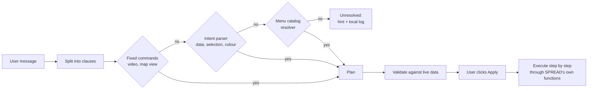
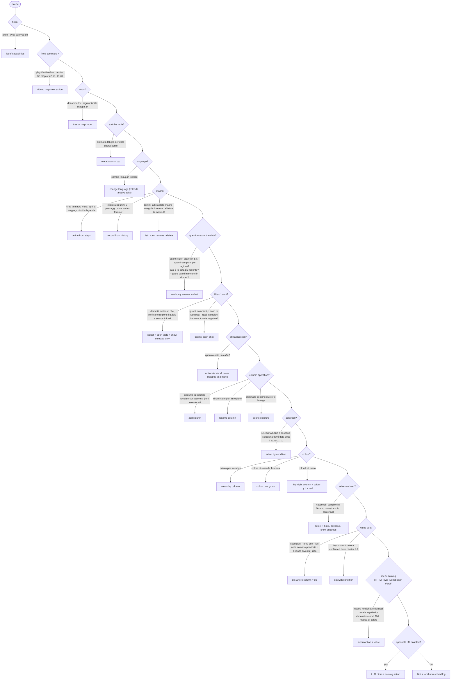
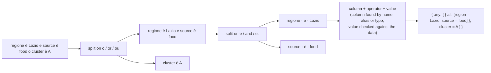

# SPREAD local assistant

This branch adds a chat assistant to SPREAD that turns plain-language requests
into SPREAD operations: *"colour by serovar"*, *"select the samples from
Teramo and hide them"*, *"show me the metadata where region is Abruzzo and
source is food"*, *"replace Roma with Rieti in the province column"*,
*"how many samples per region?"*. It works in Italian, English and French, runs
entirely in the browser and needs no model download, no GPU and no server.

This document explains how the assistant works. For SPREAD itself, see the
`main` branch.

## Contents

- [How a request is processed](#how-a-request-is-processed)
- [The parser, step by step](#the-parser-step-by-step)
- [What it understands](#what-it-understands)
- [How the parser works](#how-the-parser-works)
- [The action catalog](#the-action-catalog)
- [Safety model](#safety-model)
- [Unresolved requests](#unresolved-requests)
- [Optional local LLM](#optional-local-llm)
- [Files](#files)
- [Trying it](#trying-it)
- [Tests](#tests)
- [Extending the assistant](#extending-the-assistant)
- [Limitations](#limitations)

## How a request is processed



1. **Clauses.** A message is split on `;`, new lines, *and then* / *e poi* /
   *puis*, and on *and* / *e* / *et* when a new verb follows. So *"select
   Toscana, collapse them and then open the legend"* becomes three clauses.
   Quoted text is never split.
2. **Interpretation.** Each clause goes through three deterministic stages.
   The first stage that produces an action wins:
   - **fixed commands** for timeline playback and the map viewport;
   - the **intent parser** for operations that need parameters: metadata
     edits, selection by condition, colours;
   - the **catalog resolver** for every other option in SPREAD's menus.
3. **Plan.** The resulting actions are shown as a numbered plan, for example
   `1. Select samples: replace province = “Teramo” 2. Hide selected nodes`.
   Nothing changes until the user clicks **Apply**.
4. **Execution.** Steps run in order. Each step is validated again just before
   it runs, against the state the previous step left. A plan can therefore
   create a column and then colour by it. If a step fails, the steps already
   done are reported and the rest are skipped.
   - SPREAD propagates some changes asynchronously, for example the tree
     selection reaches the table on a timer. Steps therefore yield to the
     browser between each other, as a user clicking would.
   - Settings are applied **through their visible controls**. The assistant
     sets the slider, number box, select, toggle or radio and fires the event
     SPREAD listens to, so SPREAD's own handler updates its state and every
     control bound to it. App state and UI never drift apart.
   - Read-only answers (counts, statistics, macro lists) appear directly in
     the chat and need no confirmation.

The same input always produces the same plan.

## The parser, step by step

Each clause walks down this graph. The first branch that recognises the
clause produces the result; the edge labels are example prompts that take
that branch.



Conditions inside these branches are parsed by a small grammar:



## What it understands

Every executable option in SPREAD's menus, plus the data operations below.
Column names, values and sample IDs are matched against the loaded data,
case-insensitively and with tolerance for small typos.

| Area | Examples |
| --- | --- |
| Filter the table | `dammi i metadati che verificano regione è Abruzzo e source è food` · `show me the metadata where region is Lazio or cluster is A` · `togli il filtro` |
| Questions on the data | `quanti valori distinti ci sono nella colonna ST?` · `quanti campioni per regione dove source è food?` · `qual è il sierotipo più frequente?` · `qual è la data più recente?` · `quanti valori mancanti in cluster?` · `quali colonne ci sono?` · `how many samples are there in Toscana?` |
| Sort the table | `ordina i metadati desc per la colonna sampling_date` · `sort the table by region` · `trie le tableau par date décroissant` |
| Macros | `crea la macro Panoramica: apri la mappa, apri i metadati e chiudi la legenda` · `registra gli ultimi 3 passaggi come macro Teramo` · `dammi la lista delle macro` · `esegui la macro Panoramica` · `rinomina la macro Panoramica in Vista base` · `elimina la macro Teramo` |
| Interface | `cambia lingua in inglese` (reloads the page, always asks) · `aiuto` / `what can you do` |
| Add column | `aggiungi la colonna focolaio con valore sì per i selezionati e no per gli altri` · `add a column named batch with value B1` · `ajoute une colonne nommée lot avec la valeur L1` |
| Rename / delete column | `rinomina region in regione` · `rename column cluster to group` · `cancella le colonne cluster e lineage` |
| Replace values | `sovrascrivi i valori di Teramo nella colonna province con il valore Roma` · `cambia Milano in Monza` · `Firenze diventa Prato` · `remplace Roma par Rieti dans la colonne province` |
| Set values | `imposta outcome a negative per i selezionati` · `set cluster to Z where region is Lazio` · `imposta outcome a negative per IT-001 e IT-002` |
| Select | `seleziona i campioni del Lazio` · `seleziona Lazio o Toscana` · `select where cluster is A` · `seleziona dove regione è diverso da Lazio` · `seleziona i campioni con data dopo il 2026-01-20` · `seleziona i campioni del 2026` · `aggiungi alla selezione la Toscana` · `deseleziona tutto` |
| Select and act | `nascondi i campioni di Teramo` · `collassa quelli del Lazio` · `mostra solo i campioni positive` · `seleziona Toscana e nascondili` |
| Colour | `colora per regione` · `colour by serovar` · `colora di rosso la Toscana` · `make Toscana green` · `colora il campione IT-003 di nero` · `seleziona Teramo e colorali di rosso` |
| Menus | `mostra le etichette dei nodi` · `hide the branch labels` · `scala logaritmica` · `dimensione nodi 200` · `legenda a istogramma` · `mappa di calore` · `ordina i gruppi per nome` · `scarica la tabella in csv` · `rendering statico` · `taglia i rami più lunghi di 50` |
| Panels | `apri la mappa` · `chiudi la legenda` · `schermo intero` · `affiche la carte` |
| Views | `zoom 2x` · `dezooma 2x` · `ingrandisci la mappa 3x` · `ricentra l'albero` · `play the timeline` · `seek the timeline to 50%` · `center the map at 42.66, 13.70` |

**Conditions** support `=`, `≠` (*diverso da*, *is not*), `>`, `≥`, `<`, `≤`
(*dopo*, *prima*, *after*, *before*, *at least*), *contains*, *empty* /
*not empty*, alternatives (*Lazio o Toscana*) and conjunctions
(*source è food e region è Abruzzo*). Dates in ISO format and bare years
work. When no column is named, the parser finds the column that holds the
value. When two columns hold it, it asks which one.

**Colouring selected samples.** SPREAD colours by category, not node by node.
*"Colour the selected samples red"* is therefore a three-step plan, and every
step is visible before Apply: write `rosso` into a highlight column
(`evidenziati` / `highlight` / `surbrillance`) for the selected samples, colour
by that column, and give that value the colour red.

**Ambiguity.** When a request fits two options equally, the more common
panel wins. For example, *"mostra etichette"* means node labels. Naming the
panel (*"dei rami"*, *"nella tabella"*, *"on the map"*) picks the other one.
If two options remain genuinely tied, the assistant asks instead of guessing.

## How the parser works

The parser is rule-based. It does not understand language in general. It
recognises a closed domain, the operations SPREAD offers, using three
sources of knowledge:

1. **Hand-written vocabularies** for verbs and keywords in each language.
   *sostituisci / replace / remplace* all mean *replace*, and *colonna / column
   / colonne* all mean *column*. Words are compared after lower-casing and
   removing accents. Long words tolerate one or two typos (Levenshtein
   distance), so *"nelal colonna"* still finds the column.
2. **The loaded data.** Column names, every distinct value and every sample
   ID. *"Teramo"* is understood because it is a value of `province`, not
   because the parser knows it is a city. Common translations of column names
   (*regione → region*, *sierotipo → serovar*, *esito → outcome*) are built
   in.
3. **SPREAD's own translations** (`js/i18n/*.js`). Each menu label in the
   active language is linked to its Italian, English and French versions, so
   all three name the same option.

In NLP terms, this is **intent classification with slot filling**, done by a
**rule-based semantic parser**. Each clause becomes a typed command such as
`{ op: set, column, value, where }`. The `where` part is a small
WHERE-clause evaluated in the browser.

The **catalog resolver** handles everything that is not a data operation. It
scores each menu option by the words of the request, using TF-IDF-style
weights: a word that names only one option (*heatmap*, *logaritmica*)
outweighs a word shared by many (*mostra*, *mappa*). Several bonuses add to
the score:
- a multi-word name found verbatim (*"dimensione nodi"*);
- the request being exactly an option's name;
- a panel word (*tabella*, *map*);
- an on/off verb when the option is a switch.

It then reads the value from the request: a named option, an on/off verb or a
number within the allowed range. If the best option cannot take a value from
the request, it tries the next candidate.

## The action catalog

The catalog is not hard-coded. It is rebuilt from the live SPREAD
configuration before every request:

- tree, metadata, legend, map, video and zoom context menus;
- settings cards (node style, node size, branch style, cut-offs, rendering);
- layout toggles and macros;
- tree zoom, node colour, timeline player and map viewport controls;
- the assistant's typed data operations (`assistant:metadata-add-column`,
  `-set`, `-rename-column`, `-delete-column`, `assistant:select`).

A new SPREAD option therefore becomes available to the assistant
automatically. Extra synonyms for options that are often described in other
words live in `SYNONYMS` and `OPTION_SYNONYMS` in `js/assistant.js`.

## The panel

- **Floating.** Drag it by the header and resize it from the corner. It
  remembers its position; double-click the header to reset it.
- **Docked.** The sidebar button turns it into a full-height side panel.
  SPREAD's dashboard shrinks to make room, and the left edge sets the width.
  The dock state lives on `<html>` because SPREAD rewrites the `<body>`
  classes on every layout change.
- **Apply immediately.** The switch under the input runs plans without the
  Apply step. A language change still asks, because it reloads the page.
- **Examples** are generated from the loaded data: real columns, values and
  dates, so they always work on the current dataset.
- **Update notice.** The page polls `js/assistant-version.json`. When a newer
  build has been deployed, the panel shows *"new version available — reload"*
  and the launcher gets a dot. `tests/assistant/bump_version.py` bumps the
  build and the cache keys together.

## Safety model

- **No code execution.** The assistant can only propose actions from the
  catalog. Values are checked against the live options, numeric ranges and
  loaded columns.
- **Confirmation.** Every plan is shown before anything changes, unless the
  user switched on *Apply immediately*.
- **Questions never act.** A clause phrased as a question (*quanti*, *quali*,
  *how many*, *combien*…) is answered or reported as not understood. It is
  never mapped to a menu action.
- **Native paths.** Actions run through the same functions as SPREAD's menus.
  Metadata edits use `gtiz_metadata.updateMetadata` and `loadMetadata`, so the
  tree, map, legend and table stay consistent.
- **Protected columns.** `ID`, `CMP` and the sample column cannot be edited,
  renamed or deleted. Column names cannot contain tabs, line breaks or commas,
  because a comma in the header would switch SPREAD's reader to CSV.
- **Privacy.** Data never leaves the browser. There is no backend and no API
  call.

## Unresolved requests

When a clause cannot be mapped, the user sees a short hint with examples. The
request is also kept in the browser's `localStorage`: the last 500, never sent
anywhere. This lets maintainers see what people tried and extend the grammar
from real usage:

```js
SPREAD_ASSISTANT.unresolved()       // [{ at, lang, request, reason }, …]
SPREAD_ASSISTANT.clearUnresolved()
SPREAD_ASSISTANT.plan('colora per regione e apri la mappa')  // dry run, nothing executed
```

## Optional local LLM

The model selector in the panel defaults to **Parser only**, with no
download. A local model can be selected instead. It runs in a Web Worker
through WebLLM and WebGPU (Qwen2.5 0.5B / 1.5B / 3B; the first use downloads
several hundred MB). It is consulted only for clauses the deterministic
stages could not resolve, and it can only pick catalog actions, which are
validated like any other.

The trade-off:
- **LLM benefits:** it handles phrasings the grammar does not anticipate.
- **LLM costs:** it needs WebGPU, adds latency, and its output varies between
  runs. A wrong pick can look plausible.

A middle ground for the future is a small multilingual sentence-embedding
model. It would rank the catalog by meaning while keeping the parser for
values.

## Files

| File | Role |
| --- | --- |
| `js/assistant-intents.js` | Pure parser: clause splitting, intents, conditions, catalog resolver. No DOM access; testable in Node. |
| `js/assistant.js` | Panel UI, live catalog and context, typed data operations, validation, plan and execution, unresolved log. |
| `js/assistant-worker.js` | Optional WebLLM worker. |
| `css/assistant.css` | Panel styles. |
| `datasets/assistant-demo/` | 8-sample fixture used by the tests. |
| `datasets/assistant-showcase/` | 60 synthetic *Salmonella*-like samples (Abruzzo and other regions, sources, dates, clusters) for demos. |
| `tests/assistant/` | Test suites and live-context fixtures. |

## Trying it

Serve the repository with any static web server and open:

```
/?tree=/datasets/assistant-showcase/tree.nwk&metadata=/datasets/assistant-showcase/metadata.tsv&longitude=longitude&latitude=latitude&lang=it
```

Open **Assistente locale** / **Local assistant** at the bottom right, type a
request, review the plan and click **Apply**. `lang=en` or `lang=fr` switches
the interface language. The assistant understands all three languages
regardless.

## Tests

```bash
python tests/assistant/dump_context.py   # refresh live-context fixtures (it/en/fr) from the running app
node tests/assistant/coverage.mjs        # every executable menu option × every language
node tests/assistant/paraphrases.mjs     # free phrasings: typos, synonyms, word order, compounds
python tests/assistant/e2e.py            # browser: type, Apply, check SPREAD's real state
```

- `coverage.mjs` generates, for every executable option and each UI
  language, the phrase a user would form from the visible label. It then
  checks that the request resolves to that option with the right value: 665
  phrases.
- `paraphrases.mjs` checks about 100 hand-written free phrasings.
- `e2e.py` drives the real app in headless Chromium. It types each request,
  clicks Apply and asserts on the resulting metadata, selection and colour
  category.

The Python scripts need Playwright with a Chromium headless shell.

## Extending the assistant

- **A synonym for a menu option:** add it to `SYNONYMS`, keyed by the menu
  item id or its English label, or to `OPTION_SYNONYMS` for option values.
- **A column-name translation:** add it to `COLUMN_ALIASES` in
  `js/assistant-intents.js`.
- **A new verb or phrasing:** extend the vocabularies `W`, `CLAUSE_VERBS` and
  `OPERATORS`.
- **A new statistic or question:** extend `parseStats` in
  `js/assistant-intents.js` and `statsMessage` in `js/assistant.js`.
- **A new parametrised operation:** register a typed action in
  `registerDataOperations` with a `check` (validation) and a `function`
  (execution), then add an intent in `parseClause`.

For each change, add the phrase to `paraphrases.mjs` and run the suites. The
unresolved log is the best source of new cases.

## Limitations

- The parser recognises the phrasings it was written for. Unusual wording,
  such as adjectives standing in for values (*"campioni alimentari"* for
  `source = food`), is reported as unresolved rather than guessed.
- Values are matched whole. Replacing a substring inside values is not
  supported.
- Selection works on tree nodes. Selecting one sample of a node that groups
  several samples selects the whole node.
- Menu options that need data that is not loaded, such as ReporTree zooms
  without zoom files, are not offered.
