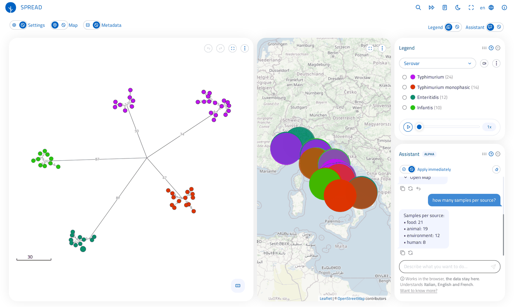

# SPREAD, Spatiotemporal Pathogen Relationships and Epidemiological Analysis Dashboard

Phylogenetic tree, map, timeline and metadata of an outbreak in one page, with an assistant you can ask in plain words.

<p align="center">
  <a href="https://genpat-it.github.io/spread/"></a>
  <a href="https://genpat-it.github.io/spread/?blank"></a>
  <a href="https://github.com/genpat-it/spread"></a>
  <a href="https://doi.org/10.12834/VetIt.3476.23846.1"></a>
</p>

<p align="center">
  <a href="https://genpat-it.github.io/spread/"></a>
</p>

Open the demo and type in the **Assistant** card, in English, Italian or French:

* `colour the tree by serovar and open the map`
* `how many samples per source?`
* `where is the logarithmic scale?`

It all runs in your browser: no installation, and your data never leave the page.

Previously known as GrapeTree Extended.

## Table of Contents

- [Description](#description)
- [Use SPREAD](#use-spread)
- [Instruction to run it locally](#instruction-to-run-it-locally)
  - [Prerequisites](#prerequisites)
  - [Install and use live-server](#install-and-use-live-server)
  - [Run SPREAD locally](#run-spread-locally)
  - [Load geoJSON or cooridates data](#load-geojson-or-cooridates-data)
  - [Localized metadata](#localized-metadata)
  - [Load files](#load-files)
  - [Metadata files](#metadata-files)
  - [Save or load a SPREAD session](#save-or-load-a-spread-session)
  - [Download the tree as an image](#download-the-tree-as-an-image)
  - [Undo and redo](#undo-and-redo)
  - [Tree shortcuts](#tree-shortcuts)
  - [Node shapes](#node-shapes)
  - [Legend](#legend)
  - [Macros](#macros)
  - [Notes](#notes)
  - [Dark mode](#dark-mode)
  - [Assistant (alpha)](#assistant-alpha)
  - [Zooms for clusters](#zooms-for-clusters)
- [Customizing SPREAD](#customizing-spread)
- [Server](#server)
- [Docker](#docker)
- [Videos](#videos)
- [Documentation](#documentation)
- [Credits](#credits)
- [License](#license)
- [Citation](#citation)

## Description

<p align="center">
<br>

<br>
</p>

# 

The project is based on [GrapeTree](https://github.com/achtman-lab/GrapeTree), a fully interactive, tree visualization program within EnteroBase, which supports facile manipulations of both tree layout and metadata. Please see more info [here](https://enterobase.readthedocs.io/en/latest/grapetree/grapetree-about.html).

The idea was to extend the original project in order to conducts spatio-temporal analyses with an integrated geographic information system (GIS) as well as a data visualization system across time. The web application allows users to upload geographic coordinates and temporal data related to each sample and allows to display them reflecting the selection in the tree on the map and vice versa, and reproducing a timelapse visualization both in the map and in the tree.

## Use SPREAD

You can download the project and easly running it locally, but we provide also a ready to use version freely available following the links below:

* [Demo](https://genpat-it.github.io/spread/): opens with a small synthetic dataset (Salmonella tree, metadata and map), to try SPREAD and its assistant at once
* [Blank](https://genpat-it.github.io/spread/?blank): opens SPREAD without data, to load your own files (Newick tree, metadata TSV, SPREAD session)

Please note, you can load sensitive data, your dataset is visualised client-side in the browser. No data is transmitted, and no tracking cookies are used. The only data downloaded from the internet are the visualisation (JavaScript) code, fonts and map tiles.

## Instruction to run it locally

To run the project locally you need to set a web server, **node packages http-server** or **live-server** works pretty fine.

### Prerequisites

* **Node js**. Download the latest stable release of NodeJS from [https://nodejs.org](https://nodejs.org) and install it using all the default options.

### Install and use live-server

Now you will be able to install `live-server` globally on your machine using the node package manager `npm` command line tool, this will allow you to run a web server from anywhere on your computer.

```
npm install live-server -g
```

To start a web server, in terminal open the directory containing your static web files and start the server with the following command:

```
live-server
```

### Run SPREAD locally

Download the .zip of the code from this repository, then unzip on a directory `DIR_SPREAD` (for example: `/tmp/spread`).

**Source files in place**

Produce your newick (`tree.nwk`) and metadata (`meta.tsv`) files and copy them inside `DIR_SPREAD`, then on terminal:

`live-server DIR_SPREAD`

Now you will be able to load data by url in your web browser, for example:

```
http://localhost:8080?tree=tree.nwk&metadata=metadata.tsv
```

In the project you will find a `datasets` folder with some example data to load, you can use url to see them as well:

```
http://localhost:8080?tree=/datasets/test/tree.nwk&metadata=/datasets/test/metadata.tsv&geo=/datasets/test/points.geojson
```

### Load geoJSON or cooridates data

The dashboard is able to recognize `.geojson` file passed as `geo` parameter by query string:

`&geo=points.geojson`

Alternatively you can integrate in `metadata.tsv` longitute and latitude values and pass them as query string parameters in the place of geoJSON. For example, if in the `.tsv` you define `x` for longitude and `y` for latitude, just add `&longitude=x&latitude=y` in the url in this way:

`&metadata=metadata.tsv&longitude=x&latitude=y`

Using our data example:

```
http://localhost:8080?tree=/datasets/test/tree.nwk&metadata=/datasets/test/metadata.tsv&longitude=x&latitude=y
```

> **Important**
>
> If you use `longitude` and `latitude` to name coordinates in the `.tsv` file, there is no need to pass them as query string parameters, so simply use: `&metadata=metadata.tsv`

> Please note that for the longitude and latitude values, decimal points should be used as separators instead of commas.

#### Using predefined country coordinates

If neither a GeoJSON file nor latitude and longitude values are provided, the application checks for a `countries` object in `app.json`, defined as follows:

```json
"countries": {
  "column": "sampling country",
  "path": "datasets/countries/countries.json",
  "latitude": "latitude",
  "longitude": "longitude"
}
```

* `column`: Specifies the metadata column containing country names.
* `path`: Defines the file path to a JSON file that maps country names to their respective coordinates.
* `latitude` and `longitude`: Define the keys used for latitude and longitude in the JSON mapping file.

The JSON file at the specified `path` should follow this structure:

```json
"iceland": {
    "latitude": 64.1355,
    "longitude": -21.8954
},
"ireland": {
    "latitude": 53.3498,
    "longitude": -6.2603
},
"italy": {
    "latitude": 41.9028,
    "longitude": 12.4964
}
```

The application compares values in the specified `column` against this mapping and assigns the corresponding coordinates accordingly.

### Localized metadata

Metadata can be provided in localized variants, so that column names and values
are shown in the language chosen by the user. The feature is switched on per
deployment by the `metadata_localization` block of `app.json`; when `enabled` is
`false`, or the block is missing, no localized file is looked up and SPREAD
behaves as it did before the feature.

```json
"metadata_localization" : {
  "enabled" : true,
  "technical_columns" : { ... }
}
```

Beside the default file, place a variant named after the language code and
SPREAD will pick it up:

```
metadata.tsv        <- default, always required
metadata_en.tsv
metadata_fr.tsv
metadata_it.tsv
```

The lookup happens when a language is explicitly requested by the `lang` query
string parameter, either because it is in the url or because the user changed
language from the UI (which adds the parameter and reloads the page):

```
http://localhost:8080?tree=tree.nwk&metadata=metadata.tsv&lang=it
```

If the variant is not there, the default file is loaded and nothing is reported:
a missing translation is a normal condition. Language codes are the ones of the
files in `js/i18n`, so `&lang=it-IT` looks for `metadata_it.tsv` and a language
SPREAD does not know falls back to `_en`, the same way the interface does.

The same convention applies to the metadata of the zoomed trees described in the
[Zooms for clusters](#zooms-for-clusters) paragraph, and the language is carried
over when a zoom is opened in a new tab. When the full tree was translated but the
zoom has no variant, the default file is loaded and a notice explains that the
settings carried over from the full tree may not match its column names.

#### Technical columns

Some columns are looked up by name, so translating their header would break the
features using them. Their translations can be declared in two places: by the
dataset, in a mapping file placed beside the localized metadata, or by the
deployment, in `app.json`. The mapping file wins, `app.json` holds the defaults.

The mapping file has the same name as the localized `.tsv` with the `.json`
extension, `metadata_it.json` beside `metadata_it.tsv`, and is looked up only
when the variant itself is found:

```json
{
  "columns" : {
    "latitude" : "Lat.",
    "longitude" : "Long.",
    "category" : "Categoria"
  },
  "values" : {
    "category" : {
      "sample of interest" : "campione di interesse"
    }
  }
}
```

`columns` maps the canonical key of a technical column to the header used by the
file, `values` maps the canonical identifier values of a column to the ones used
by the file. Both are optional. A missing mapping file is a normal condition; a
malformed one is ignored with a notice.

The deployment defaults live in `app.json`, under
`metadata_localization.technical_columns`:

```json
"metadata_localization" : {
  "enabled" : true,
  "technical_columns" : {
    "latitude" : {
      "en" : "Latitude",
      "fr" : "Latitude",
      "it" : "Latitudine"
    },
    "longitude" : {
      "en" : "Longitude",
      "fr" : "Longitude",
      "it" : "Longitudine"
    },
    "category" : {
      "en" : "Category",
      "fr" : "Catégorie",
      "it" : "Categoria",
      "values" : {
        "sample of interest" : {
          "en" : "sample of interest",
          "fr" : "échantillon d'intérêt",
          "it" : "campione di interesse"
        }
      }
    },
    "sampling country" : {
      "en" : "Sampling country",
      "fr" : "Pays de prélèvement",
      "it" : "Paese di campionamento"
    }
  }
}
```

A `default` entry can be added as a fallback for the languages not listed. Any
column not declared here is considered **not translatable** and must keep its
expected header in the localized files, namely the `MST-` prefixed columns used
by zooms and the reserved `ID` and `CMP` names. The column holding the sample
names is an exception: it is recognized by its position, so it can be translated
freely. The `sampling country` key must match the `countries.column` setting.

The `values` entry declares the translations of the values that are compared by
value, today only the samples of interest marker of the `category` column.

Declarations are offers, not obligations: a translated name or value is used
only when it is really present in the file, otherwise the canonical one is used.
A localized file may therefore keep `latitude`, `longitude`, `category` or
`sample of interest` as they are, translate some of them, or use the names of
its mapping file, and every combination resolves. Categories passed through
`zooms=` or `zooms_list=` with the canonical names are resolved the same way, so
a link written for the default file works on a variant.

> **Important**
>
> A localized file must hold the same rows as the default one and the same
> values in the sample names column, which is what links metadata to the tree.

> Values used as identifiers must not be translated either, unless declared under
> `values`: the cluster values of the `MST-` columns never, the samples of
> interest marker of the `category` column only as declared. Numeric values must
> keep the dot as decimal separator. Everything else, headers and values, can be
> translated.

Coordinates passed as query string parameters (`&latitude=` and `&longitude=`)
keep taking precedence over the declarations above.

#### Exported files

A complete JSON exported while a translation is in use embeds the metadata of
that language only, along with the language itself, the resolved names of its
technical columns and the resolved identifier values. This makes the file
self-contained: whoever loads it reads the translated dataset correctly even with
a different `app.json`, also after editing cells in the grid, and the `lang`
parameter of the url is aligned to it. The source path is stored without its
query string, so a token appended to the metadata url never ends up in the file.

Exported `.tsv` metadata carry the translated headers of the language in use, so
reloading them under a different language leaves the technical columns unresolved.

A SPREAD session saved with zooms also includes the localized metadata of each
zoom, and their mapping files, when the full tree uses localized metadata.

### Load files

You can also directly upload files by dragging them over the tree, over the initial droppable area or using load buttons provided in the UI. In this case you don't need to use parameters in the url. You can drag or load a `.nwk` file with a `.tsv` or `.xlsx` file containing metadata and optionally a `.geojson` file containing geo-spatial information: one after the other, all together, inside a folder or inside a `.zip` file.

```
my-dataset.zip
  |__ tree.nwk
  |__ metadata.tsv
  |__ points.geojson
```

> **Important**
>
> When files are loaded one after the other, the .nwk file should be loaded before loading metadata or geoJson files.

> **Please note.** When files are loaded together, in a folder or in a `.zip` file, only one file for each type is allowed (a `.tsv` and an `.xlsx` are both metadata). A SPREAD session found together with other files takes precedence over them, and the other files are ignored.

### Metadata files

Metadata can be a `.tsv` or an `.xlsx` file, loaded in the same ways: from the url (`&metadata=metadata.xlsx`, also with the localized variants such as `metadata_it.xlsx`), dragged, chosen with the load buttons, in a folder or in a `.zip` file.

* **`.tsv`**: columns are always separated by tabs, commas are part of the values and of the headers.
* **`.xlsx`**: the first sheet is read, with its first row as header; other sheets are ignored, with a notice. Every value is read as text: numbers as a spreadsheet shows them, dates as `yyyy-mm-dd`, formulas as their last calculated value. Merged cells are not allowed: the file is not loaded and the cells must be split. Old Excel files (`.xls`) are not supported, save them as `.xlsx`.

A loaded metadata file replaces the current metadata: columns and rows not in the file are removed, and the metadata table follows the order of its columns. Samples are linked to the tree by the `ID` column or, without it, by the first column.

The metadata table can be downloaded as `.tsv` or `.xlsx`, with the same contents. In the `.xlsx` file every cell is text and every column has the Text format, so values typed later in a spreadsheet are kept as they are (no `2008.0` turned into `2008`, no leading zeros removed, no automatic dates).

### Save or load a SPREAD session

Dashboard allows you to save a SPREAD session, a complete JSON file including tree, metadata, map, configurations, notes and your macros. Generated JSON file can be loaded with the same drag or load functionalities seen previously, this is very useful if you want to save your work or share it.

When zooms are available (see [Zooms for clusters](#zooms-for-clusters)), the session can also be saved together with the files of its zooms, as a `.zip` file:

```
spread1234567890.zip
  |__ spread.json
  |__ zooms.txt
  |__ Reportree_MST-7x1.0_cluster_335
        |__ MST-7x1.0_cluster_335.nwk
        |__ MST-7x1.0_cluster_335_metadata_w_partitions.tsv
  ...
```

The `.zip` file, or the folder obtained by unzipping it, can be loaded with the same drag or load functionalities, without parameters in the url: zooms are read from the file itself.

> **Please note.** Zooms that cannot be downloaded while saving are skipped and listed at the end, with the reason. If no zoom can be downloaded, no `.zip` file is saved. Zooms loaded from a `.zip` file or from a folder cannot be opened in a new tab.

The save window also allows you to export the current data as separate files, without settings: the tree as `.nwk`, the metadata as `.tsv` or `.xlsx` and the geographic data as `.geojson`. These files reflect the current state of the dashboard, changes included, and can be loaded again as described in [Load files](#load-files). The notes can be exported from the same window, see [Notes](#notes).

### Download the tree as an image

From the tree download menu you can export the current tree as an image in two formats:

* **`.png`** — a raster capture of the canvas as you currently see it, so it reflects the current zoom and pan and includes only the visible portion of the tree.
* **`.svg`** — a vector rebuild of the **whole** tree, independent of the current zoom and pan. It covers the full extent of the tree and includes links, link labels, node halos, pie wedges and node labels, together with the legend and a scale bar.

Both exports embed the theme font, so text renders with the same typeface outside the browser.

> **Please note:** choose `.svg` when you need a complete, print-quality or further editable figure, and `.png` when you want to capture exactly the view currently on screen.

### Undo and redo

The changes to the tree can be undone and redone with the two round buttons of the tree card, whose title says what they would undo or redo, or with `Ctrl+Z` / `Cmd+Z` and `Ctrl+Y` / `Ctrl+Shift+Z` / `Cmd+Shift+Z`. They cover the tree menu, the settings cards (node shapes and borders included), the legend options that change the colours of the tree and the nodes dragged in the static layout. Selection, view (zoom, panels, full screen, dark mode) and exports are not part of it, nor the map and the metadata. Loading a tree or new metadata, running a macro or applying a request of the assistant clear the history: macros and requests have their own undo.

### Tree shortcuts

The keyboard button at the bottom right of the tree card lists the shortcuts of the tree: wheel to zoom, drag to move the view, drag a node to move it with its subtree, `Shift` + drag to select the nodes in an area, `Alt` (`Option`) + drag to rotate the tree, `Alt` + left or right arrow to rotate it by 15° with the pointer on the tree, and the undo and redo keys. The rotation works in the static layout; the **Rotation** setting of the Rendering card sets an exact angle and the angle is saved in the SPREAD session.

### Node shapes

The **Node shape** card of the Settings changes the shape (circle, square, triangle, hexagon, octagon) and the border of the selected nodes, and selects the nodes by their shape or border. Every shape keeps the area of the circle, so the size of a node still reflects its samples. Shapes and borders are saved in the SPREAD session and in the settings.

### Legend

Besides colouring the tree and the map by a category, the legend can be filtered by the selection: **Filter by selection**, in the legend menu, shows only the values of the selected nodes, with their selected/total counts. The legend can be shown as a list or as a histogram, and downloaded as `.png` or `.svg`. The video player, which walks through the values of the legend one at a time, is in the legend card.

### Macros

The macros panel, opened from the top bar, collects sequences of actions: the built-in ones and the ones you record. **Rec** records the options used in menus, settings and panels; when a macro is run, the steps that do not apply to the current data (for instance a missing column or no selected node) are skipped with the reason, and **Undo macro** brings back the previous state. Your macros are kept in the browser and in the SPREAD session, and can be exported and imported as `.json` files, also by dropping the file on the tree.

### Notes

The notes panel, opened from the top bar, collects the notes of the session: a text with a simple Markdown formatting and, optionally, the samples of the selected nodes, marked on the tree, and an image of the current view. Notes are saved in the SPREAD session and can be exported and imported as `.json` files, or exported as Markdown and as a Word (`.docx`) report with the current view, the notes and the table of their samples.

### Dark mode

The button in the top bar switches between light and dark mode. Without a choice, SPREAD follows the mode of the system or of the browser; the choice is kept in the browser. Tree, map and metadata table follow the mode, while exported images are always light. Each theme sets its dark colours with `dark_vars` in `app.json`, as described in `themes/README.md`.

### Assistant (alpha)

The assistant turns requests written in plain words, in English, Italian or French, into SPREAD operations: for instance *colour by serovar*, *show me the metadata where region is Abruzzo* or *how many samples per region?*. It shows the plan before changing anything and works in the browser: the data never leave the page.

It is an **alpha** version and it is turned on in `app.json`; without this block it is off, with no card and no toggle:

```json
"assistant" : {
  "enabled" : true
}
```

## Zooms for clusters

SPREAD can be used to visualize results generated with [ReporTree](https://github.com/insapathogenomics/ReporTree). Very briefly, ReporTree allows the generation of a series of zooms on clusters by specifying samples of interest and parameters such as thresholds and distances.

In this context, it's possible to indicate to SPREAD the presence of available zooms using the methods described below.


> **Please note.**
> Here, we describe how to set up and place the needed newick and metadata files for zooms. However, if you produce these files directly with ReporTree, the structure, composition, and positions are already correct.

### Metadata columns and data

Here the minimum metadata mandatory schema:

|ID             |category            |MST-21x1.0 |MST-15x1.0 |MST-7x1.0  |MST-4x1.0 |
|---------------|--------------------|-----------|-----------|-----------|----------|
|00.00000.00.00 |sample of interest  |cluster_4  |cluster_11 |cluster_22 |cluster_32|

### Source files in place

Insert the folders containing the zooms (a newick and optionally a related .tsv metadata file) at the same level as the general tree. Following the **output generated by ReporTree**, the names of folders and files should adhere to the following conventions:

* `prefix_threshold-definition_cluster-name`: for example, `Reportree_MST-7x1.0_cluster_334`
* `prefix_sample-id_closest-name`: for example, `Reportree_sample-01_closest5`


For a concrete example, the structure should follow this convention:

```
Reportree.nwk
Reportree_metadata_w_partitions.tsv
Reportree_MST-7x1.0_cluster_335
  |__ MST-7x1.0_cluster_335.nwk
  |__ MST-7x1.0_cluster_335_metadata_w_partitions.tsv
Reportree_MST-7x1.0_cluster_887
  |__ MST-7x1.0_cluster_887.nwk
  |__ MST-7x1.0_cluster_887_metadata_w_partitions.tsv
...
```

### URL parameters

Once the zooms folders are moved as shown, it is necessary to specify some parameters, and this can be done in two ways.

#### 1. All information needed are in the metatada file

There are 2 parameters to specify: `zooms`, which is mandatory, and `zooms_prefix`, which is optional.

* `zooms` parameter can have one of the following syntax:
  - `zooms=category,sample%20of%20interest@5,7`: the code will find in the general metadata file the clusters for the samples marked as sample of interest for the indicated thresholds.
  - `zooms=category,sample%20of%20interest@all`: the code will find in the general metadata file the clusters for the samples marked as sample of interest for all thresholds.
  - `zooms=@7,21`: The code will use `category` and `sample of interest` by default to find clusters in the general metadata file for the indicated thresholds.
  - `zooms=all`: The code will use `category` and `sample of interest` by default to find clusters in the general metadata file for all thresholds.

> **Please note.** As permitted by ReporTree, different thresholds can be separated by commas (e.g., @5,8,16), but you can also define ranges by specifying them with a hyphen to separate the minimum and maximum (e.g., @5,8,10-20).

* `zooms_prefix` should define a prefix used for files and folders. This is optional, by default application take it from the `.nwk` file name.
  - `zooms_prefix=zoom` indicates that folder names and file names start with `zoom_`.

#### 2. Provide an index

At the same level as the zoom folders, alternatively, it's possible to insert a .txt file (for example `zooms.txt`) containing a simple list of `prefix_threshold-name_cluster-name` for each zoom folder in the full tree root. By using this index, it is possible to cover a second use case, that of closest zooms, and it is also possible to indicate elements in the list composed as follows: `prefix_sample-name_closest-name`. To give a more concrete example:

```
Reportree_MST-7x1.0_cluster_335
Reportree_MST-7x1.0_cluster_510
Reportree_MST-7x1.0_cluster_519
Reportree_MST-15x1.0_cluster_556
Reportree_sample-01_closest5
Reportree_sample-01_closest10
Reportree_sample-02_closest5
Reportree_sample-02_closest10
```

then add in the URL one of the following parameters:

* `zooms_list=category,sample%20of%20interest@zooms.txt`: the code will find in the general metadata file the clusters for the samples marked as sample of interest for zooms indicated by `zooms.txt` file.
* `zooms_list=@zooms.txt` or `zooms_list=zooms.txt`: the code will use `category` and `sample of interest` by default to find clusters in the general metadata file for zooms indicated by `zooms.txt` file.

> **Please note.** The `prefix` should match the name of the `.nwk` file.

To keep the zooms when you save or share your work, save a SPREAD session with zooms as described in [Save or load a SPREAD session](#save-or-load-a-spread-session).

## Customizing SPREAD

SPREAD allows you to customize some elements of its appearance such as colors, fonts, header elements (logo and title), and footer content.

It is also possible to set SPREAD to **read-only** mode by changing the `read_only` parameter in `app.json` to `true`.

> **Please note:** read-only mode hides download buttons and limits edit functions at the UI level only.

Themes can also define the colours of the dark mode, see [Dark mode](#dark-mode).

Please find more information on [wiki](https://github.com/genpat-it/spread/wiki/Customizing-SPREAD)

## Server

You can use SPREAD with the provided `server.js` by running the following command:

```bash
npm start
```

This server acts as a proxy, allowing you to download resources using the `withProxy` parameter in the query string. For example:

```
http://localhost:8080/?tree=https://example.com/tree.nwk&withProxy
```

You can set custom variables to control the proxy:

- `SERVER_JSON_LIMIT=10mb`
- `SERVER_URLENCODED_LIMIT=5mb`
- `SERVER_MAX_DOWNLOAD_SIZE_KB=1024`
- `SERVER_ALLOWED_DOMAINS_FOR_DOWNLOAD=domain1.com,domain2.com`
- `SERVER_ALLOWED_LOCAL_ROOTS=/absolute/path/one,/absolute/path/two`

`SERVER_ALLOWED_LOCAL_ROOTS` limits which local folders can be served when you request files with a `file://` URL (for example `http://localhost:8080/index.html?tree=file:///path/to/tree.nwk&withProxy`). By default it falls back to the project directory.

Example:

Windows:
```
set SERVER_JSON_LIMIT=2mb && set SERVER_URLENCODED_LIMIT=2mb && set SERVER_MAX_DOWNLOAD_SIZE_KB=1024 && set SERVER_ALLOWED_LOCAL_ROOTS=C:\data\spread && node server.js
```

Linux:
```
SERVER_JSON_LIMIT=2mb SERVER_URLENCODED_LIMIT=2mb SERVER_MAX_DOWNLOAD_SIZE_KB=1024 SERVER_ALLOWED_LOCAL_ROOTS=/data/spread node server.js
```

You can also specify your proxy:

```
http://localhost:8080/?tree=https://example.com/tree.nwk&withProxy=https://myproxy.com
```

SPREAD will use the following format for the proxy URL: `https://myproxy.com/download?url={url}`

## Docker

### Building from Github Container

```bash
docker pull ghcr.io/genpat-it/spread:latest
docker run -d -p 3000:8080 --name spread ghcr.io/genpat-it/spread:latest
```
You can surf the spread instance by visiting `http://<IP_ADDRESS_OR_HOSTNAME>:3000`  in your web browser.

### Building from Source

To build the Docker image from the source code, follow these steps:

1. Clone the repository:

```bash
git clone https://github.com/genpat-it/spread
```

2. Navigate to the cloned directory:

```bash
cd spread
```

3. Build the Docker image using the provided Dockerfile. You can also specify the port using the `PORT` build argument:

```bash
docker build . -t spread --build-arg PORT=3000
```

4. Once the image is built, you can run the Docker container:

```bash
docker run -d spread
```

This will expose the application running inside the container on port 3000 of your host machine.

## Videos

- **Video Settings:** [Watch Video](https://genpat.izs.it/genpat_wiki/Dashboards/SPREAD/2023-08-04-grapetree-settings.mp4) - This video demonstrates the settings configuration in SPREAD.

- **Video Upload:** [Watch Video](https://genpat.izs.it/genpat_wiki/Dashboards/SPREAD/2023-08-04-grapetree-upload.mp4) - This video shows how to upload data in SPREAD.

## Documentation

* [https://github.com/genpat-it/spread/wiki](https://github.com/genpat-it/spread/wiki)
* [https://genpat.izs.it/wiki/en/Dashboards/SPREAD/SPREAD.html](https://genpat.izs.it/wiki/en/Dashboards/SPREAD/SPREAD.html)
* [https://enterobase.readthedocs.io/en/latest/grapetree/grapetree-about.html](https://enterobase.readthedocs.io/en/latest/grapetree/grapetree-about.html)

## Credits

### Tree

* [https://github.com/achtman-lab/GrapeTree](https://github.com/achtman-lab/GrapeTree)

### Map

* [https://www.openstreetmap.org/](https://www.openstreetmap.org/)
* [https://leafletjs.com/](https://leafletjs.com/) 

### Metadata table

* [https://github.com/ag-grid/ag-grid](https://github.com/ag-grid/ag-grid)

### Icons

* [https://tabler.io/icons](https://tabler.io/icons)

## License

This program is free software: you can redistribute it and/or modify it under the terms of the GNU General Public License as published by the Free Software Foundation, either version 3 of the License, or (at your option) any later version.

This program is distributed in the hope that it will be useful, but without any warranty; without even the implied warranty of merchantability or fitness for a particular purpose. See the GNU General Public License for more details.

You should have received a copy of the GNU General Public License along with this program. If not, see [http://www.gnu.org/licenses/](http://www.gnu.org/licenses/).

## Citation

If you run SPREAD, please cite publications:

de Ruvo, A., De Luca, A., Bucciacchio, A., Castelli, P., Di Lorenzo, A., Radomski, N., Di Pasquale, A. SPREAD: Spatiotemporal Pathogen Relationships and Epidemiological Analysis Dashboard. Veterinaria Italiana, Vol. 60 No. 4 (2024): Special Issue GeoVet23. https://doi.org/10.12834/VetIt.3476.23846.1 

De Luca, A., de Ruvo, A., Di Lorenzo, A., Bucciacchio, A., Di Pasquale, A. GrapeTree integration with spatio-temporal data visualization: a holistic understanding of diseases and the transmission pathways. GeoVet23 (2023). [Poster](https://www.veterinariaitaliana.izs.it/index.php/GEOVET23/article/view/3224)

Also, SPREAD relies on the work of other developers. So, there are other tools that you must cite:

* ReporTree: https://genomemedicine.biomedcentral.com/articles/10.1186/s13073-023-01196-1
* GrapeTree: http://www.genome.org/cgi/doi/10.1101/gr.232397.117
