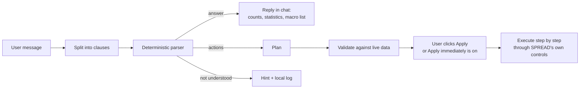
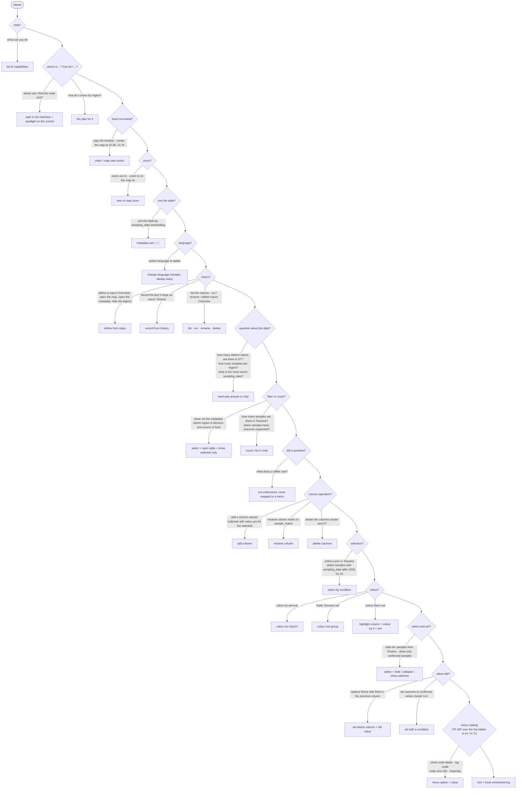
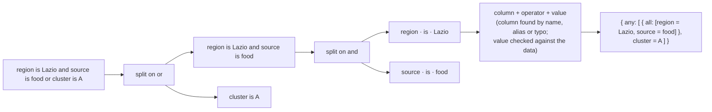

# SPREAD local assistant

This branch adds a chat assistant to SPREAD that turns plain-language requests
into SPREAD operations, for example:

- *"colour by serovar"*
- *"hide the samples from Teramo"*
- *"show me the metadata where region is Abruzzo and source is food"*
- *"replace Roma with Rieti in the province column"*
- *"how many samples per region?"*

It understands English, Italian and French. It runs entirely in the browser:
there is no model to download, no GPU and no server, and the data never leaves
the page.

This document explains how the assistant works. For SPREAD itself, see the
`main` branch. The [option reference](docs/ASSISTANT_REFERENCE.md) lists every
SPREAD option: where it is in the interface, what it does and what to type.
The panel is marked **alpha**: some requests may not be understood yet. All examples below are in English; the same requests work in
Italian and French.

## Contents

- [How a request is processed](#how-a-request-is-processed)
- [The parser, step by step](#the-parser-step-by-step)
- [What it understands](#what-it-understands)
- [How the parser works](#how-the-parser-works)
- [The action catalog](#the-action-catalog)
- [The panel](#the-panel)
- [Safety model](#safety-model)
- [Unresolved requests](#unresolved-requests)
- [Files](#files)
- [Trying it](#trying-it)
- [Tests](#tests)
- [Extending the assistant](#extending-the-assistant)
- [Limitations](#limitations)

## How a request is processed



1. **Clauses.** A message is split on `;`, new lines, *and then* / *then*, and
   on *and* or a comma when a new verb follows. So *"select Toscana, collapse
   them and then open the legend"* becomes three clauses. Quoted text is never
   split, and a one-line macro definition is kept whole.
2. **Interpretation.** Each clause goes through the parser shown below. The
   result is a read-only answer, a list of typed actions, or a short hint when
   the clause was not understood.
3. **Plan.** Actions are shown as a numbered plan, for example
   `1. Select samples: replace province = “Teramo” 2. Hide selected nodes`.
   Nothing changes until the user clicks **Apply**, unless *Apply
   immediately* is switched on.
4. **Execution.** Steps run in order. Each step is validated again just before
   it runs, against the state the previous step left. A plan can therefore
   create a column and then colour by it. If a step fails, the steps already
   done are reported and the rest are skipped.
   - SPREAD propagates some changes asynchronously, for example the tree
     selection reaches the table on a timer. Steps therefore yield to the
     browser between each other, as a user clicking would.
   - Settings are applied **through their visible controls**. The assistant
     sets the slider, number box, select, toggle or radio and fires the event
     SPREAD listens to, so SPREAD's own handler updates its state and every
     control bound to it. App state and UI never drift apart.

The same input always produces the same plan.

## The parser, step by step

Each clause walks down this graph. The first branch that recognises the
clause produces the result. Each edge label is an example prompt that takes
that branch.



Conditions inside these branches are parsed by a small grammar:



*and* between **values of the same column** means both groups: *"select
Enteritidis and Typhimurium"* becomes `serovar ∈ {Enteritidis, Typhimurium}`.
An AND on one column could never match.

## What it understands

Every executable option in SPREAD's menus, plus the operations below. Column
names, values and sample IDs are matched against the loaded data,
case-insensitively and with tolerance for typos.

| Area | Examples |
| --- | --- |
| Filter the table | `show me the metadata where region is Abruzzo and source is food` · `show me the metadata where region is Lazio or cluster is A` · `clear the filter` |
| Questions on the data | `how many distinct values are there in ST?` · `how many samples per region?` · `how many samples per region where source is food?` · `what is the most common serovar?` · `what is the most recent sampling_date?` · `how many missing values in cluster?` · `which columns are there?` · `how many samples are there in Toscana?` |
| Select | `select Lazio or Toscana` · `select Enteritidis and Typhimurium` · `select where region is not Lazio` · `select samples with sampling_date after 2026-01-10` · `select samples from 2026` · `deselect all` |
| Select and act | `hide the samples from Teramo` · `collapse cluster A` · `show only confirmed samples` · `select Toscana and hide them` |
| Colour | `colour by serovar` · `make Toscana red` · `set the colour of sample IT-003 to black` · `select Teramo and colour them blue` |
| Columns | `add a column named outbreak with value yes for the selected and no for the others` · `rename column matrix to sample_matrix` · `delete the columns cluster and ST` |
| Values | `replace Roma with Rieti in the province column` · `change Milano to Monza` · `set outcome to confirmed where cluster is A` · `set outcome to negative for the selected samples` |
| Sort and export | `sort the table by sampling_date descending` · `sort the table by region` · `export the table as csv` |
| Macros | `define a macro Overview: open the map, open the metadata, hide the legend` · `record the last 3 steps as macro Teramo` · `list the macros` · `run macro Overview` · `rename macro Overview to Base view` · `delete macro Teramo` |
| Menus | `show node labels` · `hide the branch labels` · `log scale` · `node size 200` · `show the legend as a histogram` · `heatmap` · `sort groups alphabetically` · `download the image as png` |
| Panels | `open the map` · `close the legend` · `full screen` |
| Views | `zoom 2x` · `zoom out 2x` · `zoom in on the map 3x` · `recenter MST` · `play the timeline` · `timeline speed 2x` · `seek the timeline to 50%` · `center the map at 42.66, 13.70` |
| Orientation | `where can I find the node size?` · `where is the log scale?` · `where are the macros?` · `how do I colour by region?` |
| Shared selection | `show them on the map` · `show them in the table` (the selection is shared by tree, map and table) |
| Interface | `what can you do` · `switch language to Italian` (reloads the page, always asks) · `clear the chat` |

**Conditions** support `=`, `≠` (*is not*), `>`, `≥`, `<`, `≤` (*after*,
*before*, *at least*), *contains*, *empty* / *not empty*, alternatives
(*Lazio or Toscana*) and conjunctions (*source is food and region is
Abruzzo*). ISO dates and bare years work. When no column is named, the parser
finds the column that holds the value; when two columns hold it, it asks which
one.

**Typos.** Small mistakes are tolerated directly: one or two letters per word.
Larger ones go through a did-you-mean step: the clearly best candidate, word by
word, is used only when it is well ahead of the runner-up. *"Entiritdis"*
becomes `Enteritidis` and *"Typhimurum monophasik"* becomes `Typhimurium
monophasic`. The plan always shows the corrected value before Apply.

**Colouring selected samples.** SPREAD colours by category, not node by node.
*"Colour them red"* is therefore a three-step plan, and every step is visible
before Apply: write `red` into a `highlight` column for the selected samples,
colour by that column, and give that value the colour red.

**Ambiguity.** When a request fits two options equally, the more common
panel wins. For example, *"show labels"* means node labels. Naming the panel
(*"of branches"*, *"in the table"*, *"on the map"*) picks the other one. If
two options remain genuinely tied, the assistant asks instead of guessing.

## How the parser works

The parser is rule-based. It does not understand language in general. It
recognises a closed domain, the operations SPREAD offers, using three
sources of knowledge:

1. **Hand-written vocabularies** for verbs, keywords and operators in each
   language. *replace / sostituisci / remplace* all mean *replace*, and
   *column / colonna / colonne* all mean *column*. Words are compared after
   lower-casing and removing accents, with typo tolerance (Levenshtein
   distance).
2. **The loaded data.** Column names, every distinct value and every sample
   ID. *"Teramo"* is understood because it is a value of `province`, not
   because the parser knows it is a city. Common translations of column names
   (*region*, *serovar*, *outcome*, *sampling date*) are built in.
3. **SPREAD's own translations** (`js/i18n/*.js`). Each menu label in the
   active language is linked to its English, Italian and French versions, so
   all three name the same option.

In NLP terms, this is **intent classification with slot filling**, done by a
**rule-based semantic parser**. Each clause becomes a typed command such as
`{ op: set, column, value, where }`. The `where` part is a small WHERE-clause
evaluated in the browser.

The **catalog resolver** handles every menu option that is not a data
operation. It scores each option by the words of the request, with TF-IDF-style
weights: a word that names only one option (*heatmap*, *logarithmic*)
outweighs a word shared by many (*show*, *map*). Bonuses are added for:

- a multi-word name found verbatim (*"node size"*);
- the request being exactly an option's name;
- a panel word (*table*, *map*);
- an on/off verb when the option is a switch.

It then reads the value from the request: a named option, an on/off verb or a
number in range. A number alone never picks an option; some word must name
it. If the best option cannot take a value from the request, the next
candidate is tried.

## The action catalog

The catalog is not hard-coded. It is rebuilt from the live SPREAD
configuration before every request:

- tree, metadata, legend, map, video and zoom context menus;
- settings cards (node style, node size, branch style, cut-offs, rendering);
- layout toggles and SPREAD's own macros;
- tree zoom, node colour, timeline player and map viewport controls;
- the assistant's typed operations: `assistant:metadata-add-column`,
  `-set`, `-rename-column`, `-delete-column`, `-sort`, `assistant:select`,
  `assistant:language`.

A new SPREAD option therefore becomes available to the assistant
automatically. Extra synonyms for options that are often described in other
words live in `SYNONYMS` and `OPTION_SYNONYMS` in `js/assistant.js`.

## The panel

- **Floating.** Drag it by the header and resize it from the corner. It
  remembers its position; double-click the header to reset it.
- **Docked.** The sidebar button turns it into a side panel aligned with
  SPREAD's cards: same top and bottom edges, same right margin. SPREAD's
  dashboard shrinks to make room, and the left edge sets the width. The dock
  state lives on `<html>` because SPREAD rewrites the `<body>` classes on every
  layout change.
- **Apply immediately.** The switch under the input runs plans without the
  Apply step. A language change still asks, because it reloads the page.
- **Prompt history.** ↑ and ↓ in the input walk through sent prompts, as in a
  shell. The last 100 are kept, and the draft being typed is restored at the
  end of the list.
- **Examples** are generated from the loaded data (real columns, values and
  dates), so they always work on the current dataset.
- **Update notice.** The page polls `js/assistant-version.json`. When a newer
  build has been deployed, the panel shows *"new version available — reload"*
  and the launcher gets a dot. `tests/assistant/bump_version.py` bumps the
  build and the cache keys together.

## Orientation and documentation

*"Where can I find …?"* answers with the path in the interface, for example
`Settings › Node size › Radius size (%)`. It adds SPREAD's own help text for
that control and a command that does it directly. The assistant then shows
the control: it opens the panel, expands the card or opens the ⋮ menu, dims
the page around the control and zooms a pulsing ring onto it. The ring follows
the control while the layout settles and disappears after a few seconds or on
click.

The same location data produces [docs/ASSISTANT_REFERENCE.md](docs/ASSISTANT_REFERENCE.md),
so the documentation cannot drift from the software. To regenerate it:

```bash
python tests/assistant/dump_context.py          # live catalog + locations (en/it/fr)
node tests/assistant/reference_examples.mjs     # English examples, kept only if the parser resolves them
python tests/assistant/reference.py             # writes docs/ASSISTANT_REFERENCE.md
```

## Safety model

- **No code execution.** Only catalog actions can run. Values are checked
  against the live options, numeric ranges and loaded columns.
- **Confirmation.** Every plan is shown before anything changes, unless the
  user switched on *Apply immediately*.
- **Questions never act.** A clause phrased as a question (*how many*,
  *which*, *what*…) is answered or reported as not understood. It is never
  mapped to a menu action.
- **Native paths.** Actions run through the same controls and functions as
  SPREAD's menus. Metadata edits use `gtiz_metadata.updateMetadata` and
  `loadMetadata`, so the tree, map, legend and table stay consistent.
- **Protected columns.** `ID`, `CMP` and the sample column cannot be edited,
  renamed or deleted. Column names cannot contain tabs, line breaks or commas,
  because a comma in the header would switch SPREAD's reader to CSV.
- **Privacy.** Data never leaves the browser. There is no backend and no
  network call.

## Unresolved requests

When a clause cannot be mapped, the user sees a short hint with examples. The
request is also kept in the browser's `localStorage`: the last 500, never sent
anywhere. This lets maintainers see what people tried and extend the grammar
from real usage:

```js
SPREAD_ASSISTANT.unresolved()       // [{ at, lang, request, reason }, …]
SPREAD_ASSISTANT.clearUnresolved()
SPREAD_ASSISTANT.plan('colour by region and open the map')  // dry run, nothing executed
SPREAD_ASSISTANT.macros()           // saved assistant macros
```

## Files

| File | Role |
| --- | --- |
| `js/assistant-intents.js` | Pure parser: clause splitting, intents, conditions, statistics, macros, catalog resolver. No DOM access; testable in Node. |
| `js/assistant.js` | Panel UI, live catalog and context, typed operations, validation, plan and execution, statistics answers, macros, prompt history, unresolved log. |
| `js/assistant-version.json` | Deployed build number, polled for the update notice. |
| `css/assistant.css` | Panel styles, based on SPREAD's theme variables. |
| `datasets/assistant-demo/` | 8-sample fixture used by the tests. |
| `datasets/assistant-showcase/` | 60 synthetic *Salmonella*-like samples (Abruzzo and other regions, sources, dates, clusters) for demos. |
| `tests/assistant/` | Test suites, live-context fixtures and helper scripts. |

## Trying it

Serve the repository with any static web server and open:

```
/?tree=/datasets/assistant-showcase/tree.nwk&metadata=/datasets/assistant-showcase/metadata.tsv&longitude=longitude&latitude=latitude&lang=en
```

Open **Local assistant** at the bottom right, type a request, review the plan
and click **Apply**. `lang=it` or `lang=fr` switches the interface language.
The assistant understands all three languages regardless.

## Tests

```bash
python tests/assistant/dump_context.py   # refresh live-context fixtures (en/it/fr) from the running app
node tests/assistant/coverage.mjs        # every executable menu option × every language
node tests/assistant/paraphrases.mjs     # free phrasings: typos, synonyms, word order, compounds
python tests/assistant/e2e.py            # browser: type, Apply, check SPREAD's real state
python tests/assistant/capability_map.py out.html   # coverage map page (after coverage.mjs --json)
```

- `coverage.mjs` generates, for every executable option and each UI
  language, the phrase a user would form from the visible label. It then
  checks that the request resolves to that option with the right value: 665
  phrases.
- `paraphrases.mjs` checks about 100 hand-written free phrasings.
- `e2e.py` drives the real app in headless Chromium. It types each request,
  clicks Apply, and checks the resulting metadata, selection, table filter
  and sort, slider values, macros and prompt history.

The Python scripts need Playwright with a Chromium headless shell.

## Extending the assistant

- **A synonym for a menu option:** add it to `SYNONYMS`, keyed by the menu
  item id or its English label, or to `OPTION_SYNONYMS` for option values.
- **A column-name translation:** add it to `COLUMN_ALIASES` in
  `js/assistant-intents.js`.
- **A new verb or phrasing:** extend the vocabularies `W`, `CLAUSE_VERBS` and
  `OPERATORS`.
- **A new statistic or question:** extend `parseStats` in
  `js/assistant-intents.js` and `statsMessage` in `js/assistant.js`.
- **A new parametrised operation:** register a typed action in
  `registerDataOperations` with a `check` (validation) and a `function`
  (execution), then add an intent in `parseClause`.

For each change, add the phrase to `paraphrases.mjs` and run the suites. The
unresolved log is the best source of new cases.

## Limitations

- The parser recognises the phrasings it was written for. Unusual wording,
  such as an adjective standing in for a value (*"food samples"* for
  `source = food`), is reported as unresolved rather than guessed.
- Values are matched whole. Replacing a substring inside values is not
  supported.
- Only ISO dates and bare years are understood; relative dates (*"last
  week"*) are not.
- Selection works on tree nodes. Selecting one sample of a node that groups
  several samples selects the whole node.
- Menu options that need data that is not loaded, such as ReporTree zooms
  without zoom files, are not offered.
- File loading, map lasso selection and undo/redo are not available through
  the assistant.
